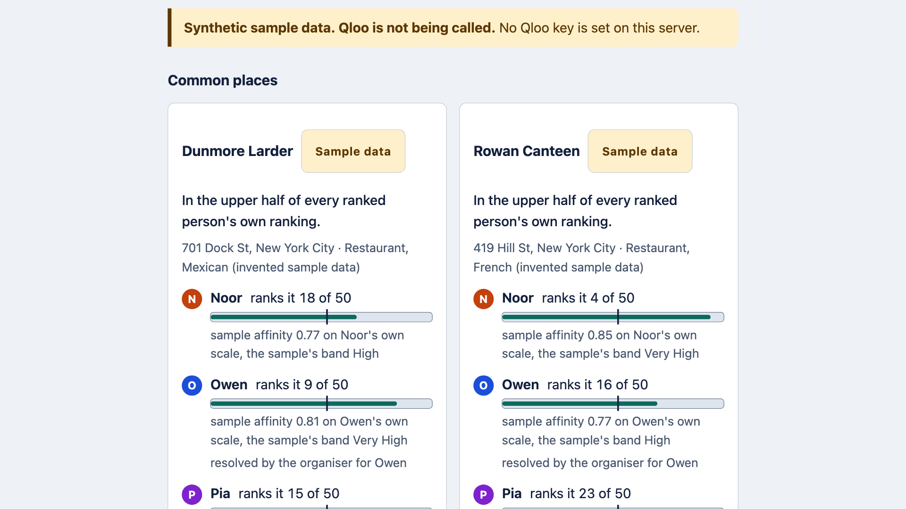
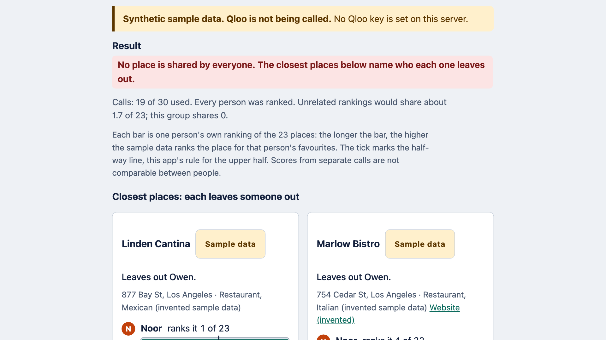
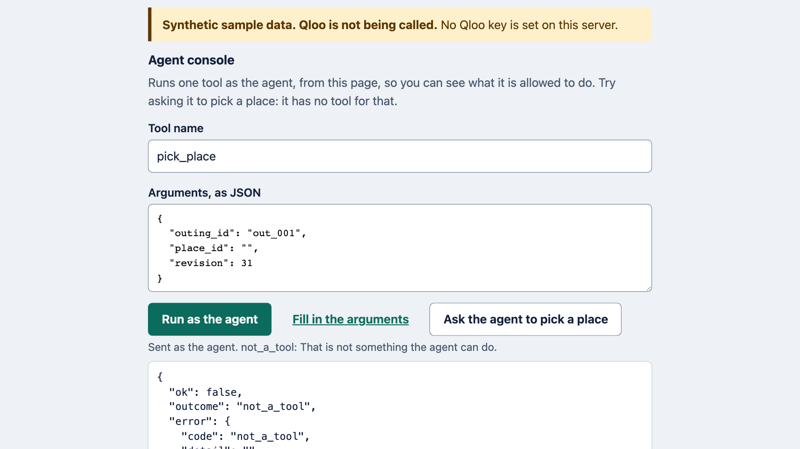

# Common Ground: one bar per person, no averaged taste

**A group picks where to go. Each person names a few favourites, and an agent asks Qloo where every place
stands in each person's own ranking. You see one bar per person on every pick, and nobody's taste is averaged
away. People say which match they meant; only the organiser picks a place or signs off a message.**



Common Ground is a one-person project: a group-outing planner built on Qloo's taste API as a hackathon entry (theme:
"Agents, but with taste"; [hackathon page](https://qloo.devpost.com/)). Qloo played no part in building it and has not
reviewed it, and the project is not affiliated with or endorsed by Qloo.

## Try it in 60 seconds

You need Python 3.11 or newer and nothing else: no package, no key, no account.

```bash
python3 -m common_ground serve      # then open http://127.0.0.1:8761/
```

1. Click **Try the sample group**: four fictional friends, Noor, Owen, Pia and Quinn, with two favourites each.
2. Click **Resolve Noor's matches**, then the same button for Owen, Pia and Quinn.
3. Choose **Restaurant**, click **Use this kind**, then **Compare places**. The status line reads "5 places are in the
   upper half of every ranked person's own ranking. 14 of 30 calls used.", and every card has one bar per person.
4. Under **Agent console**, click **Ask the agent to pick a place**. The answer is `not_a_tool`, and no pick is
   recorded: picking is a person's verb, and the agent has no tool for it.

```bash
python3 -m unittest discover -s tests -t . -q   # 675 tests, offline, about eight seconds
```

Hosted demo: <!-- hosted-url -->

**Why sample data.** This build went public before Qloo's API key came (it was requested on 17 October), so every
place, rank and affinity on screen is invented, and the page says so with a banner and a "Sample data" stamp on each
card. The live path is written: `common_ground probe` checks Qloo's real response shapes once a key exists, and the
live source refuses every call until it has.

## Why this exists

Noor (fictional) is planning a Friday dinner for four friends. Each has two favourites, and none of them is a
restaurant: a film, a band, a book, a show. She wants a short list of places and a reason for each, and she
wants to know who a place leaves out before she suggests it.

An average cannot tell her that. A place that three people love and one person would dread can still score well.
So Common Ground never averages. It keeps each person's standing separate and shows it:

- **Whose taste is in a place.** Every pick carries one bar per person.
- **Who would be left out.** A place is common only when it sits in the upper half of every person's own
  ranking, and the page names who is outside when none is.
- **Which condition is doing the harm.** The day or the price band may be what excludes someone. Loosening one
  is a human decision, and the agent has no tool for it.

It never contacts anyone. An invitation or a booking request goes out in your name, so only you can release it,
and the app only drafts it.

## Why not average, swipe or ask a language model

The usual ways of choosing for a group each hide the person who loses.

- **Swipe and match.** Apps of this kind put the same places in front of everyone and call it a match when all of
  them say yes. They find agreement only among places someone has already listed, each person has to judge every
  card, and what a person loves outside restaurants (a film, a band) plays no part.
- **Blend everyone's signal.** Group recommenders that merge the members' tastes return one score per place for the
  group. A high group score can hide the one person a place fails, and a single number cannot say who that is.
- **Ask a language model.** It names places from memory. It holds no per-person ranking of any place, so it presents
  a guess as agreement.

Common Ground asks Qloo for a separate ranking per person over one shared candidate list: the group search returns
up to 50 places, and each person's own favourites rank those same places. Common places are ordered by the rank of
the person each one serves least, which is the least-misery strategy from group-recommender research (Masthoff,
2004), applied to ranks rather than ratings. "No place is shared by everyone" is a real answer, shown in those
words, rather than a weaker place presented as agreement. Qloo's taste graph holds the figures, and every one of
them on a card is labelled with where it came from.

## What happens when you use it

1. You describe the outing: a label, the day, a price band, a city or neighbourhood, and each person with up to
   three favourites. **Type the names of public things only** (a restaurant, a band, a film, a show, a book, a
   brand): each name is sent to Qloo to find a match. People can add favourites of their own from a personal
   link.
2. The agent searches Qloo for each favourite and lists candidate matches. A person says which one they meant,
   or you say it for them and the page records that you did. Nothing is used until it has been resolved this way,
   which follows Qloo's own advice to show resolved matches before relying on them. You choose the kind of
   place from tags Qloo returned.
3. **One search for the group.** Qloo's Insights API for places, anchored on everyone's resolved favourites,
   with your conditions applied inside Qloo: the city, the day the place must be open, the price level and the
   kind. Up to 50 places come back. They are the long list.
4. **One ranking per person.** For each person, the same request again, with only that person's favourites as
   the signal, your conditions re-sent, and the long list's ids as the places to rank. Qloo returns the long list
   in that person's own order.
5. **It stops when the answer is known.** A place is common when it is in the upper half of every person's own
   ranking. When someone's ranking leaves no common place, no later ranking can restore one, so the agent stops
   and reports how many rankings it did not spend.
6. **You read evidence, not a score.** A card shows one bar per person, as long as that person ranks the place
   high. Beside each bar are Qloo's affinity for that person's favourites, Qloo's band for that number, and the
   favourites that explain it.
7. **"No place is shared by everyone" is a valid result.** The page says so in those words and lists the closest
   places, each naming who it leaves out. It never relaxes a condition itself.
8. **You pick, draft and sign off.** Picking a place that leaves someone out asks you to say who. The agent drafts
   an invitation and a booking request; each reads DRAFT until you name yourself as sender and sign off. A
   signed-off message is text to copy. Nothing is sent, booked or paid by the app.

## Reading the board

The page is one flow, top to bottom: describe the outing, say which match each person meant, choose the kind of
place, compare, pick, draft, sign off. Each step reveals the next, and the status line under the heading says in
words what just happened.



- **A card per place.** Each person has a row: a coloured initial, the name, "ranks it 4 of 50", and a bar. The bar
  is as long as that person ranks the place high, so the top of their list fills it and the bottom leaves a sliver.
  A tick across every bar marks that person's own upper half; a common place is one whose every bar reaches its tick.
  The bars are drawn from rank alone.
- **The figures, opened on request.** Under "Why this place" sit that person's affinity as a labelled number on their
  own scale, with the line "Scores from separate calls are not comparable between people", Qloo's band for it, and
  the favourites that explain it. When Qloo gives no affinity or no explanation, the card says so in words and shows
  no figure.
- **Three results.** Places in the upper half of every ranked person's own ranking; or "No place is shared by
  everyone" with the closest places and who each leaves out; or "No place comes close" when Qloo ranked only part of
  the long list. If a person has not been ranked yet (a limit stopped the comparison), a banner says a common place
  may still leave them out, and the pick asks you to say you know.
- **Stamps.** A place from invented data carries a "Sample data" stamp, and a message waiting for sign-off carries a
  DRAFT stamp, so nothing is read as more than it is.
- **Pick.** A place that leaves someone out, or someone not yet ranked, asks you to tick a box naming each of them
  before the Pick button works. Ruling a place out needs a reason, which stays with it.
- **Drafts.** The agent writes an invitation and a booking request. Each reads DRAFT until you name the sender and
  sign off. A signed-off message is text on the page: **Copy the message** (which selects the text instead when the
  browser refuses clipboard access), **Open in your mail app** (a link with no recipient) and **Plain text**. The
  app never sends, books or pays.
- **A person's own link.** It shows only that person's favourites. They can choose the match they meant, which the
  organiser's page then labels "resolved by" their name, and add a favourite of their own. The organiser's page runs
  the Qloo search for it, because a member's link can run only the two verbs that are theirs.
- **The agent console.** A tool name and its arguments as JSON, always run as the agent, with the answer shown in
  full. "Ask the agent to pick a place" fills in a pick and runs it, to show that the answer is `not_a_tool`.
- **The trace and the call strip.** Every call or stop the agent made, with the reason, sits under "What the agent
  did". The strip counts the workspace's Qloo calls, oldest first, split into live, answered from the cache and on
  sample data, which is not Qloo.

## The fairness rule

Each figure on a card says whose it is.

| On a card | Whose | Source |
|---|---|---|
| A person's **rank** of a place | Qloo's order for that person's favourites, counted by this app | That person's ranking call |
| The **bar** | Drawn from the rank: longer means higher in that person's own ranking | This app |
| A person's **affinity** | Qloo's figure for that person's query, labelled as that person's own scale and not comparable between people | That person's ranking call |
| The **band** beside it | Qloo's: above 0.8 Very High, 0.6 to 0.8 High, below 0.5 Low; no label where Qloo names none | A lookup |
| **Because** | Qloo's explainability scores of 0.1 and above, naming which favourites explain a place | That person's ranking call |
| `common`, `near`, "left out", "upper half" | **This app's rule** | The rule below |

**The rule.** For each person, the upper half of their ranking is the first half of the long list, plus any place
whose affinity is within 0.02 of the half-way place (or, when Qloo returns no affinity, within two ranks of it),
so a tie at the line is not decided by one position. A place is **common** when it is in every person's upper
half. Common places are ordered by the rank of the person each one serves least, then by the sum of ranks, then
by Qloo's order. A place is **near** when it is not common and only a minority of the people ranked so far fall
outside its upper half; at most three are shown, each naming who is left out. Nothing is averaged and there is no
composite score.

**When no place is shared by everyone,** the page says "no place is shared by everyone", lists up to three closest
places (each with who it leaves out and where it stands in that person's own ranking), prints the line comparing
the result with chance (this group shares 0), and says how many rankings were not spent and who was not ranked.
It offers no other place and loosens nothing: changing the day, the price, the city or the kind is yours.

**A closest place always exists once everyone is ranked.** When every ranking covers the whole long list, the
upper halves together hold at least half of the places for each person, so some place sits in at least half of
them and leaves out at most half of the people: it is common or near. So the page can say "no place is shared by
everyone" and still show closest places. It says "no place comes close" only when Qloo ranked part of the long
list for someone, because a place missing from a person's ranking counts as outside that person's upper half; it
then also says "Qloo ranked only n of m places for {name}".

**Why position and not raw affinity.** Qloo's guide to reading affinity says, about comparing brands, that scores
are normalised per query and should be read by relative position, and that 0.91 against 0.92 usually means
similar relevance. Each person's ranking is its own query, so this app applies the same reasoning to people:
position decides, and the raw number is shown only as that person's own. That is this entry's inference, not
Qloo's statement. The half-way line and the 0.02 tolerance are this app's choices, and the page says so.

**What group size does to the odds.** If everyone's rankings were unrelated, a place would land in all the upper
halves with probability one half to the power of the group's size. Over 50 places that is about 12.5 common places
for two people, 6.3 for three, 3.1 for four, 1.6 for five and 0.8 for six. Because the search is anchored on
everyone, real rankings are related and the real count should be higher. Every result prints "unrelated
rankings would share about X of M; this group shares Y", so a small number for a large group is not read as a
verdict on that group.

## What Qloo contributes

All places on screen originate in Qloo's answers. Take Qloo away and three things vanish: the catalogue of places,
the bridge from a film or a band to a place, and a separate ranking for each person. The base URL is
`https://hackathon.api.qloo.com`; the key is sent in the `X-Api-Key` header and nowhere else.

| Endpoint | Parameters sent | What is read | Job |
|---|---|---|---|
| `GET /search` | `query` (a favourite as typed), `types`, `take` | candidate entities: id, name, type, popularity, disambiguation | Turns a name into an entity a person can resolve |
| `GET /v2/tags` | `filter.query` | tag ids and names | Finds a valid tag for the kind of place; Qloo does not take free-text tags |
| `GET /v2/insights`, the group search | `filter.type=urn:entity:place`, `signal.interests.entities` (all resolved favourites), `filter.exclude.entities`, `filter.location.query`, `filter.hours`, `filter.price_level.min` and `.max`, `filter.tags`, `feature.explainability=true`, `take=50` | places with tags, address and Qloo's own fields | Applies the group's conditions inside Qloo and returns candidates for everyone together |
| `GET /v2/insights`, one person's ranking | `filter.type=urn:entity:place`, `signal.interests.entities` (that person only), `filter.results.entities` (the long list), the same location, day, price and kind, `feature.explainability=true`, `take` | the long list in that person's order, with affinity and explainability | One person's own ranking of the same places |

Every request is built from a per-endpoint list of allowed parameters, because Qloo ignores any parameter it does
not recognise without saying so. Common Ground never sends `signal.demographics.*` or anything about a person's
identity; Qloo describes aggregate affinities, which are not evidence about an individual.

### A request traced end to end, ids elided

Every id in the two requests below is a stand-in, and nothing here is a Qloo response (this repository holds
none). First, the group search for the sample group:

```
GET https://hackathon.api.qloo.com/v2/insights
    ?filter.type=urn:entity:place
    &signal.interests.entities=<favourite 1>,<favourite 2>,…,<favourite 8>
    &filter.exclude.entities=<the same eight ids>
    &filter.location.query=<the city as typed>
    &filter.hours=friday
    &filter.price_level.min=2&filter.price_level.max=3
    &filter.tags=<the kind tag id Qloo returned>
    &feature.explainability=true
    &take=50
X-Api-Key: <redacted: a header only, never in a URL, never logged>
```

then one person's ranking:

```
GET https://hackathon.api.qloo.com/v2/insights
    ?filter.type=urn:entity:place
    &signal.interests.entities=<that person's favourite 1>,<that person's favourite 2>
    &filter.results.entities=<all 50 ids from the group search>
    &filter.location.query=<the city as typed>
    &filter.hours=friday
    &filter.price_level.min=2&filter.price_level.max=3
    &filter.tags=<the kind tag id Qloo returned>
    &feature.explainability=true
    &take=50
```

- **Entity choice.** Each favourite id is one Qloo returned for a name someone typed and a person resolved. The
  only other ids sent are ones Qloo itself returned.
- **Tag choice.** The kind tag came from `GET /v2/tags` for a word such as "restaurant", and you chose it. Any tag
  id Qloo did not return is refused.
- **What is read.** From each result: name, id, type, tags, address, position in the response, affinity, and the
  explainability scores naming which favourites explain it. Nothing else is kept.
- **What it becomes.** One line on a card, each part labelled (the format is shown, the numbers are not from any
  response): "Owen: ranks it 4 of 50 in his own ranking (this app counts Qloo's order) · affinity 0.71 on his own
  scale, Qloo's band High (Qloo's figures) · explained by his film, 0.42 (Qloo's explainability)".

The field names above are the ones Qloo's documentation shows, and no real response has been read yet. The key-day
probe compares them with real responses, and the live source refuses to run until it has. Every shape the app reads,
the pass marks the probe is judged by, and what is still unmeasured are listed in
[docs/api-notes.md](docs/api-notes.md). If Qloo cannot rank the whole long list for one person in a single request,
the probe writes no settings and the live source stays off, because any substitute would be weaker.

**Spending.** Live calls are counted per outing. The default limit is 30, which covers the largest outing (six
people with three favourites each, 26 calls); only you can lift it, to at most 60. Answers are cached privately on
the server for 24 hours. The agent's own comparisons also draw on a per-workspace daily allowance, and a hosted
server has a daily ceiling. Those counters sit in memory and restart with the server, so each bounds one run of the
server and is not a calendar day; Qloo's quota is the durable limit. Nothing degrades silently: with no key, or once
the ceiling is spent, a banner says what you are looking at.

## Who may do what



**What drives the app.** Plain Python, not a model. A deterministic procedure uses the same tools the page's buttons
use, all through one `dispatch(tool, args, actor)` function, and writes the reason for every call it makes or skips
into a trace. A language-model agent attached over MCP gets the same tools and ends up in the same place: it can
draft, and it can't commit.

| | Agent | You (the organiser) | A member, from their own link |
|---|---|---|---|
| Describe the outing and the people | Yes | Yes | No |
| Search for a favourite or a tag | Yes, inside the call limit | Yes | No |
| Say which match a favourite meant | **Never** | Yes, for a person, and it is recorded as yours | Yes, their own |
| Add a favourite to a person | **Never** | Yes, for a person, and it is recorded | Yes, their own |
| Compare places, show evidence | Yes, inside the limits | Yes | No |
| Draft an invitation or booking request | Yes | Yes | No |
| Pick a place | **Never** | Yes | No |
| Sign off a message | **Never** | Yes, after naming the sender | No |
| Change the day, price, city or kind | **Never** | Yes | No |
| Rule out a place, with a reason | **Never** | Yes | No |
| Spend past the call limit | **Never** | Yes, up to 60 | No |
| Contact, invite, book or pay anyone | Nobody, in this app | You, outside it | No |

The seven human verbs (`resolve_match`, `add_own_favourite`, `pick_place`, `sign_off_message`,
`change_conditions`, `rule_out_place`, `lift_call_limit`) are **never registered as a tool**. An agent cannot
discover them, and the dispatch function refuses them for the agent even when they are called directly. Tests
prove both. Nothing is ever "booked": a place is picked, and a message is a draft or signed off.

**Resolved by whom.** When you resolve a match for someone else, the page stores it as `organiser_for`, and
every card that rests on it says "resolved by the organiser for {name}". An invitation never names a favourite the
organiser resolved on someone's behalf. A resolution belongs to one outing and is never reused in another.

**How the page tells you from the agent.** Opening the page gives your browser a workspace cookie (`HttpOnly`,
`SameSite=Strict`). On the page's API only a request that presents that cookie and is marked
`Sec-Fetch-Site: same-origin` by the browser counts as you; page script cannot set that marker. If the cookie arrives
without it (a script, `curl`), the request is treated as the agent rather than refused. A member's personal link
follows the same rule for that member's two verbs. Every other caller, namely the command line's agent mode, the agent
console and any connected agent, is the agent.

Browsers attach the marker only on HTTPS pages (and on `localhost`), which is why a hosted copy has to be HTTPS. A
page loaded insecurely, or in a browser that sends no marker, shows a banner and disables the buttons that need you;
the agent console and your own agent over MCP keep working.

This holds against the agent's interfaces. It does **not** hold against a program running as your user that can read
your browser's cookies, against a script holding your cookie that also sends a browser's `Sec-Fetch-Site` header (the
header is an honest label, not a secret), or against an agent clicking the page's buttons: those act as you.

## Tools an agent can call

| Tool | What it does | What it does NOT do |
|---|---|---|
| `open_outing` | Starts an outing: label, day, price band, city, people and their favourites (names only) | Search anything or resolve a match |
| `look_up_favourite` | One Qloo search for one favourite; up to five candidates | Pick one, or use an unresolved entity |
| `look_up_kind` | One Qloo tag search for a word such as "restaurant" | Choose a tag, or accept one Qloo did not return |
| `run_comparison` | One group search, then one ranking per person, stopping when the answer is known | Exceed a limit, change a condition, pick a place, or contact anyone |
| `show_evidence` | Returns the stored evidence for one place | Call Qloo |
| `write_draft` | Writes a DRAFT invitation or booking request | Invent a time, price or availability, or send anything |
| `read_outing` | Reads the outing, without any token | Write anything |
| `spend_report` | Calls spent and left, cache hits, allowances | Return the key |

## Use your own agent over MCP

For MCP clients and scripts, the page shows the organiser an agent address of the form
`https://<demo address>/agent/<token>`, carrying its own random token; it reaches that workspace alone and always counts
as the agent, whatever cookie or label the request also carries. Claude Code can connect with `claude mcp add
--transport http common-ground <agent address>/mcp`. That single `/mcp` endpoint answers `POST` only, and serves
protocol revision 2026-07-28 (stateless: no handshake and no session, every request carrying its version, with
`server/discover`) and, for clients that open with `initialize`, revisions 2025-11-25 and 2025-06-18, which it
answers without issuing a session id. It offers `tools/list` and `tools/call` only (plus `ping` in the two older
revisions), and no resources, prompts or server-initiated requests. A script can `GET <agent address>/tools` and
`POST <agent address>/dispatch` with `{"tool": "…", "args": {…}}`. The seven human verbs are not on the list, and asking
for one yields `not_a_tool` (a JSON-RPC invalid-params error, with that name in its data, over MCP). A refusal for a
listed tool (a limit reached, a stale revision) comes back as a tool result with `isError` set. A client that
can only launch a subprocess runs `python3 -m common_ground mcp --address <agent address>` instead (`py -3` on
Windows). That program reads one JSON-RPC message per line on stdin, posts each to the hosted `/mcp` endpoint with
the headers that endpoint reads worked out from the message (stdio has none), and writes each answer as one line.
It has no tools of its own, so it offers the same eight tools and refuses the same seven verbs, as the agent. It needs
no key and reads no settings, answers one request at a time, never writes the address (which holds the token) to
a line, an error or its log, and ends with status 0 when its input closes. For Claude Code, from a clone of this
repository: `claude mcp add common-ground -e PYTHONPATH=<path to the clone> -- python3 -m common_ground mcp
--address <agent address>`.

## Live data and sample data
The banner at the top of each page says which of two modes you are in. In *live* mode the server makes real Qloo
calls; the key comes from an environment variable, a local `.env` or the file `COMMON_GROUND_ENV_FILE` names, stays
on the server, and is never put in a URL, logged or shown to the browser. The hosted demo is in whichever mode its
banner names, and it is in *sample* mode until the first live check has passed. In *sample* mode,
the default when no key is set, the places and the Qloo-shaped responses are invented, so the tests and a fresh
clone work offline; the banner then reads "Synthetic sample data. Qloo is not being called."

**No Qloo response is stored in this repository.** Qloo lets you cache responses privately on a server but not publish
them, so everything checked into this tree (fixtures, scenarios, test data) is made up, and a test fails when a
Qloo-shaped entity id appears anywhere in it.

**When the server's daily ceiling of live calls is spent,** an outing keeps the source it opened on. An outing opened
live stops with `daily_ceiling_spent` and its own banner, and is never switched to invented data. A **new** outing,
opened after the ceiling was spent, runs on the sample source, and its banner reads "Daily ceiling spent: showing
synthetic sample data", so a visitor does not meet a dead end and nobody mistakes the answer for Qloo's. The command
line has no sample source to fall back to.

**Live calibration has not been done.** Every response shape the live source reads is the documentation's, and none
has met a real response; the live source refuses to run until the key-day probe has checked them. Everything above
that says what Qloo returns describes what the documentation shows.

The free host behind the hosted demo stops its program after 15 minutes without traffic. The next visitor waits
about a minute while it restarts, and finds it empty: earlier workspaces, personal links and cached Qloo responses
are gone, and the first sample run makes its live calls again. A workspace lives exactly as long as the program;
nothing is promised beyond that.

## Data that leaves your machine

On a local run, only these reach Qloo:

- the favourite names you typed, and the entity ids that were resolved;
- the ids of the long list's places;
- the city or neighbourhood text, the day, the price levels, and the radius if you set one;
- the tag id you chose.

Staying on the machine that runs the app: the people's names, the outing's label, the `when` label, your drafts, your
sender name and your sign-offs.

Qloo's safe-use note says not to send names or other personal data merely to make a demo work. So type the names of
public things only: the page repeats this beside each favourite box, caps a favourite at 60 characters, and does not
log it. Give a city or a neighbourhood, never an address.

Because the hosted server runs the app, it also sees what you enter. That stays in memory while the program runs,
and nothing is logged per request.

## Accessibility

Every control is reachable and operable from the keyboard, and Enter in a text box presses the button beside it.
Focus moves to the next thing to do after each action, and a re-render puts it back where it was. Controls carry
labels, each status line is a live region, and nothing is told by colour alone: a bar has its rank in words, a stamp
its text. The palette has a light and a dark scheme, and `tests/test_contrast.py` computes the contrast ratio of every
text and border pair in both and fails below 4.5:1 for text and 3:1 for borders and the focus ring. Movement is
turned off under `prefers-reduced-motion`, targets are 44 px, and the page has no horizontal scroll down to 375 px.
It loads nothing from another host and holds no inline script or style, which its content security policy enforces.

## Run it yourself

No package needs installing, only Python 3.11 or newer. Every command below exists today and has to pass from a
fresh clone:

```bash
python3 -m common_ground serve                      # sample data, no key: open the address it prints
cp .env.example .env                                # then set QLOO_API_KEY for live mode
python3 -m common_ground serve                      # live mode
COMMON_GROUND_ENV_FILE=/path/to/qloo.env python3 -m common_ground serve   # a key kept outside the repository
python3 -m common_ground plan scenarios/friday-table.json --provider fake # the agent, from the command line
python3 -m common_ground budget                     # calls spent and left; never prints the key
python3 -m common_ground mcp --address <agent address>   # a stdio MCP relay to a hosted agent address
python3 -m unittest discover -s tests -t . -q       # every test runs offline
./verify.sh                                         # everything above that needs no key
```

On Windows, use `py -3` in place of `python3`.

`python3 -m tests.browser_rig CASE` serves the real page around a source that makes a state the plain command cannot
reach, so it can be looked at in a browser: `none_shared`, `none_close`, `thin_list`, `small_limit`,
`no_explainability`, `nothing_known`, `ceiling_soon`, `ceiling_spent` and `qloo_down`. It only ever listens on
loopback and makes no network call. `--proxy-port` adds a second port that strips the browser's `Sec-Fetch-*` labels,
which is what a browser that sends none looks like, and `--host cg.localhost` gives the plain-HTTP banner.

`serve` prints the address it listens on (`http://127.0.0.1:8761/` by default) and the mode. Open it, click **Try
the sample group**, say which match each person meant (one click per person, recorded as yours, or open a person's
own link), choose the kind of place, and click **Compare places**. Without a key the sample data is invented and a
banner says so.

By default the server binds to `127.0.0.1:8761`. It uses only the standard library, keeps every workspace in memory,
reads the page's files once at start-up (restart it after editing `web/`), and writes no per-request log. `COMMON_GROUND_PORT` changes the port, and a port injected by a
host (`PORT`) overrides it. To serve from a host: bind `COMMON_GROUND_BIND=0.0.0.0`, list the host's name in
`COMMON_GROUND_ALLOWED_HOSTS` (Render's `RENDER_EXTERNAL_HOSTNAME` is picked up on its own), set
`COMMON_GROUND_TRUST_PROXY=1` when a proxy sits in front, and terminate HTTPS at the host or the proxy, because the
person gate depends on it.

`plan` walks a scenario file through the same `dispatch` function the page uses, printing each step, then the
trace (every call or stop with its reason, who started it and the calls used so far) and the result. By default it
runs as you, the organiser: it takes Qloo's first candidate for each favourite and the first tag Qloo returns, and
records each resolution as the organiser's. `--as agent` runs only what an agent may do: it searches, is refused
at the first match it is asked to resolve (`not_a_tool`) and stops. `--provider live` with no key prints
`key: missing` and exits with status 2; with a key it is still refused (`shapes_unverified`) until the key-day
probe has checked real responses, and in both cases nothing is sent. `budget` prints the limits in force, the key
status (set or missing, never the key) and, given a scenario file, the most calls it would make.

The first thing to do with a key of your own is `python3 -m common_ground probe --favourite … --favourite …
--favourite …` (a restaurant, a band and a film, in that order). It makes at most 14 calls and never retries one. It
exercises the response shapes the app relies on, including whether one request can rank the whole long list for one
person, and reports only shapes, counts and status codes, never a value or the key.

What the server refuses before a tool runs: a `Host` that is not an allowed name (everywhere but `/healthz`), a
cross-site or same-site request to the page's API, a POST whose `Origin` is not the server's own (the server's own
origin is `https` except on a loopback name, so a plain-HTTP page at a public name is refused as `bad_origin`), a body
that is not `application/json` or is over 64 KiB, and more than 30 dispatches a minute per workspace, per member link
or per agent address (creating a workspace is limited to 30 a minute per client and 120 in all). The server runs at
most 64 handler threads and answers a request beyond that with 503 at once. A tool call holds only its own
workspace's lock, so one workspace's slow Qloo call never makes another wait, and the per-outing limit, the agent's
allowance and the daily ceiling stay exact when calls race.

`./verify.sh` is the single command before a push. It reads the documents and the example settings for anything
that must not be there, then compiles the package and runs every test offline.

## Putting it on a host

The person gate needs HTTPS, so a hosted copy is only useful behind it. [docs/deploy.md](docs/deploy.md) gives two ways,
field by field: a free Render web service (start command `python -m common_ground serve`, the port from `PORT`, health
check `/healthz`) and one EC2 instance behind Caddy (`deploy/ec2/user-data.sh`, a boot script that stops before it
installs anything when the provider is live and the key line is empty, pins Caddy with a SHA-512, and waits for its own
certificate). Both start on `COMMON_GROUND_PROVIDER=fake`, the sample source, because a live server refuses every call
until the probe has checked Qloo's response shapes; switching to `live` is one variable on Render and a new instance on
EC2. `tests/test_host_files.py` reads both files against the server's settings and its `serve` command, starts the
server the way Render does, and runs the boot script against stubs. What only a real deploy can show is listed under
"Not verified" in the guide.

## Limits

### What the evidence cannot say

- It cannot say the best place for your group was found. Only the places in the long list (the group search's
  first 50) are ranked; a place outside the long list is never checked. Ranks are also relative, so a common
  place can still carry a Low band for someone, which is why the band sits next to the bar.
- It cannot say anyone will like a place. Qloo's figures describe how its audiences relate to the things a person
  named. They are not a prediction about that person, and no card turns them into a rating of one.
- It cannot say a place is open at a given time, has room for your group, or what it costs. Qloo's day filter is a
  day of the week and its price level is a 1 to 4 band; a booking request asks the place.
- It cannot say anything about a favourite Qloo has no data for; the card says "nothing known".
- It cannot tell you who to write to. Qloo holds no contact details; you add the recipient.
- It cannot guarantee a common place exists. For six people, chance alone makes one unlikely, and the page says so.

### Not done yet

- **No live calibration.** The app has never called Qloo. Every response shape it reads is the documentation's, the
  readers are tested on invented fixtures shaped like it, and the live source refuses to run until the key-day probe has
  checked real responses. What the probe decides is in [docs/api-notes.md](docs/api-notes.md).
- **No real MCP client session.** The hosted endpoint and the stdio relay are tested with scripted clients only.
- **The cold start is unmeasured.** The free host's wake-up takes about a minute by its own account, and the first
  sample run after it repeats its calls; how long that run takes there has not been timed.
- **One browser, one machine.** The walks below used a Chromium-based browser. Firefox, Safari, a physical phone and a
  screen reader were not tried.

### Claims we decline to make

- No language model runs inside the app.
- Nothing is shown as booked, reserved or confirmed by a place.
- "Common" means the upper half of each person's own ranking of the long list, as Qloo orders it, under this
  app's rule. It does not mean agreement.
- "A person's own click" is claimed only where the person used their own link; otherwise the page says the
  organiser resolved the match on their behalf.
- The group, the outing and the people are fictional. The things they love are real public things that Qloo
  resolves, shown only through what Qloo returns.

## Roadmap

- A day-trip mode using Qloo's destination type.
- A "not tonight" tag each person can set, applied as an exclusion by the organiser.
- Qloo's analysis endpoint, to show what two people's favourites have in common.

**Who would pay.**

- **Venue, reservation and ticketing platforms.** A group holding concert tickets still needs somewhere to eat before
  the show. The platform knows who is going and on which night, and a short list that shows each person's standing is
  a reason for the group to book through it.
- **Team dinners and offsites.** The organiser answers to everyone and must not leave anyone out. A bar per person,
  and "no place is shared by everyone" when that is the truth, is what they can show the team.
- **Any assistant, over MCP.** The hosted endpoint already serves the eight tools, so an assistant asked to plan a
  group evening can call them, and it still has no tool to pick a place or sign a message off.

**What one group costs**, in Qloo calls, as the code counts them: one search per favourite, one tag search, one group
search and one ranking per person. Four people with two favourites each come to at most 14 calls (8, 1, 1 and 4); six
people with three each, the largest outing, to at most 26. The comparison spends fewer rankings when it can already
tell that no place is shared by everyone, and answers are cached privately on the server for 24 hours.

## Progress notes

Each row gets its real date as the work lands.

| Date (2026) | Step | Status |
|---|---|---|
| 20 Oct | The plan, the licence and the verification script. No application code | Done |
| 20 Oct | The key-free core, first half: request builders and allowlist, response readers, the fairness rule, drafts, the outing document, invented answers, and the key-day probe run against a local stand-in | Done |
| 20 Oct | The key-free core, second half: the live source behind a refusal that holds until real response shapes are checked, the tool registry, the human verbs, the one dispatch function, the comparison, and `plan` and `budget` on the command line | Done |
| 21 Oct | The server, the page and the hosted MCP endpoint, on the synthetic source: the guards and limits of the route table, both MCP eras on one path, the outing form, each person's matches (the organiser's click recorded and labelled, or the person's own link), the kind of place, the comparison and its cards | Done |
| 21 Oct | The board with a bar per person, picking, drafts and sign-off, a member's own favourites, the agent console, the trace and call strip, every banner and state, the accessibility pass, and a sample source for new outings once the day's live calls are spent, all on the synthetic source | Done |
| 21 Oct | The stdio relay, the deploy files for Render and for EC2 with Caddy, `docs/deploy.md`, and the tests that tie them to the server's settings and start command | Done |
| 30 Oct | The README and the submission copy reworked after an independent review: the product first, then the status | Done |

### What the browser walk showed (21 Oct, on the synthetic source)

The server was started with `python3 -m common_ground serve` and opened at `http://127.0.0.1:8761/` in a real
browser, at desktop width (1100 px) in light mode and at 375 px in light and dark. Nothing scrolled sideways at any
width and the console held no error.

- **Keyboard only, at 375 px.** Nineteen Tab presses from the top reach "Try the sample group"; Enter runs the
  sample (nine calls: eight favourite searches and the kind word) and puts focus on the heading "Say which match each
  person meant". Tab, Tab, Tab reaches "Resolve Noor's matches"; Enter records it and moves focus to the next
  person's first candidate, so two Tabs and Enter resolve each further person. After the last person focus is on the
  kind heading; an arrow key picks Restaurant, Tab and Enter on "Use this kind" moves focus to "Compare places", and
  Enter runs it. The result heading takes focus and the status line reads "5 places are in the upper half of every
  ranked person's own ranking. 14 of 30 calls used." Eight cards follow (five common, three near), each person's
  row reading "ranks it N of 50", and every card whose figures rest on a match the organiser resolved says "resolved by
  the organiser for {name}" under that person.
- **A person's own link.** Pia's link, opened in a second tab, showed only Pia's two favourites. Choosing a different
  candidate for one and resolving gave "Matched to Patagonia (tv show) (resolved by Pia)" while the other favourite
  kept "(resolved by the organiser for Pia)".
- **Found and fixed on the way.** Focus fell to the page after "Resolve" because that button disables itself once
  its person is done; focus now moves to the next thing to do. A native `<summary>` lost its marker; it is back.
- **Not seen then.** The plain-HTTP and missing-label banners. The built-in browser would not load this machine's
  LAN address, and no browser here omits `Sec-Fetch-Site`. The next walk reached both another way.

### What the browser walk showed (21 Oct, the board and the rest, on the synthetic source)

The built-in browser (a Chromium-based one) loaded the pages from loopback: `python3 -m common_ground serve` for the
sample group, and `tests/browser_rig.py` for the states `serve` cannot reach. Widths were 1100 px and 375 px, in light
and in dark. Where a case needed the live source, the rig drives it through a stand-in on loopback with a made-up key,
so the banner reads "Live: Qloo is being called" while nothing leaves the machine.

- **Keyboard only, at 1100 px.** Nineteen Tab presses from the top reach "Try the sample group", and Enter runs the
  sample and puts focus on the heading "Say which match each person meant". Three Tabs reach "Resolve Noor's
  matches"; Enter records it and, for each later person, Tab, Tab, Enter does the same. Focus then lands on the kind
  heading, Tab and the Down arrow choose Restaurant, Tab and Enter on "Use this kind", then Enter on "Compare places".
  The heading "Result" takes focus and the status line reads "5 places are in the upper half of every ranked person's
  own ranking. 14 of 30 calls used." On the first card Tab visits the website link, "Why this place", "Pick Sorrel
  Kitchen" and "Rule this place out", in that order. Enter on Pick says "Sorrel Kitchen is picked. Nothing is booked,
  sent or paid." and moves focus to "Pick, draft and sign off"; Tab reaches "Draft the invitation", whose result
  reads "The invitation is a DRAFT. Name the sender and sign it off to release it." Four Tabs reach the sender box;
  after typing a name, Tab reaches "Sign off" (it was disabled until a name was there), Enter signs the message off
  and puts focus on "Copy the message". The browser refused clipboard access, so Enter on it selected the text and
  said "Copying was blocked here. The text is selected: press Ctrl+C (Cmd+C on a Mac)."
- **No place shared by everyone.** The result reads "No place is shared by everyone. The closest places below name who
  each one leaves out. 12 of 30 calls used." and the strip adds that two calls were not spent, the chance line (about
  12.5 of 50 for unrelated rankings, this group shares 0) and who was not ranked. Picking the first closest place
  asked for a tick against three names; afterwards the page read "You said you know it leaves out, or has no ranking
  for" and the three names.
- **No place comes close, a thin long list and a call limit.** "No place comes close: Qloo ranked only part of the
  long list…" with "Qloo ranked only 4 of 12 places for Noor" and its three siblings; "Too few places came back to
  compare people, so nothing was ranked", with the returned places listed under "not ranked"; and, at a limit of 11,
  "This outing has used all 11 of its Qloo calls. Only you can raise the limit, to at most 60", where raising it to 31
  and comparing again gave 14 of 31 calls and the full answer.
- **The daily ceiling.** On a live outing with a ceiling of 12 calls, the banners read "Live: Qloo is being called
  (key: set)" and then, once the ceiling stopped the comparison, "Daily ceiling spent: live Qloo calls are refused for
  this outing until the day changes (UTC) or the server restarts. It is never switched to sample data", with a second
  banner naming the two people not yet ranked. Planning another outing opened it on sample data with its own banner
  ("Daily ceiling spent: showing synthetic sample data") and a "Sample data" stamp on every card, and the call strip
  read "26 Qloo calls in this workspace, oldest first: 12 live, 0 from the cache, 14 on sample data." The page also hit
  the workspace's 30-a-minute limit while being driven fast, and said "Waiting 38 s before trying again" and carried
  on by itself.
- **Qloo down, nothing found, a workspace gone.** "Qloo could not be reached. Try again in a moment." after the
  failure is injected at the insights endpoint; for a favourite the sample source answers nothing for, "Qloo returned
  nothing for that search" and then "Qloo found nothing for “Nothing Known”, so it is not used" with "Search Qloo
  again"; after the server was restarted under an open tab, "This workspace is gone…".
- **No explanation, no affinity.** With both left out, the card says "The sample data gave no explanation for this
  place, so no favourite is named" and the strip says "The sample data returned an order without affinity figures, so
  none is shown"; no number appears.
- **The two gate banners.** Through a loopback proxy that strips every `Sec-Fetch-*` header, the page showed "Your
  browser does not label requests, so you cannot resolve a match or sign off here", every button that needs a person
  was disabled, and the agent address was withheld. At `http://cg.localhost:8771/`, a plain-HTTP page on a name the
  server does not count as loopback, it showed "This page was loaded over plain HTTP…" and the line that the server
  refuses every request from there (`bad_origin`).
- **A person's own link, at 375 px, light and dark.** One column, no sideways scroll, the banner on top, each
  favourite with its candidates and the note "Synthetic sample data, not from Qloo". Choosing another candidate and
  pressing "Resolve Owen's matches" changed the label from "resolved by the organiser for Owen" to "resolved by
  Owen". A favourite the member adds waits on the organiser's page as "Not searched yet, so not used", with a
  button that runs the search. Enter in the add box adds it, in both pages.
- **The board, at 375 px in dark.** The cards stack, each bar sits under its name with the tick across it, and the
  page does not scroll sideways.
- **The agent console.** "Ask the agent to pick a place" answered "Sent as the agent. not_a_tool: That is not something
  the agent can do."; the pick was not recorded.
- **The console held no script error.** The only entries were the browser's lines for the 429 and 401 answers above,
  which the page handles.
- **Found and fixed on the way.** Enter in a text box did nothing until each box got the same keyboard behaviour as its
  button; after drafting, focus fell back to the section heading (the Sign off button is disabled until a name is typed) and
  now goes to the sender box; a comparison cut short by a limit
  showed a "common" place without saying that someone had not been ranked, and now carries a banner that says so; the
  upper-half tick was set by an inline style, which the content security policy forbids, and is now set through the
  style object.
- **Not seen.** Firefox and Safari: the bars are styled for both, and only Chromium was looked at. A real phone, a
  screen reader (the live regions were read from the page's structure, not heard) and this machine's LAN address.
  The clipboard's success path, because the browser refused it. The agent-allowance message, which a test and the
  page's sentence cover. Any live call: no key exists.

## License

[MIT](./LICENSE). Qloo's data is third-party material under Qloo's own terms and is not part of this repository.
